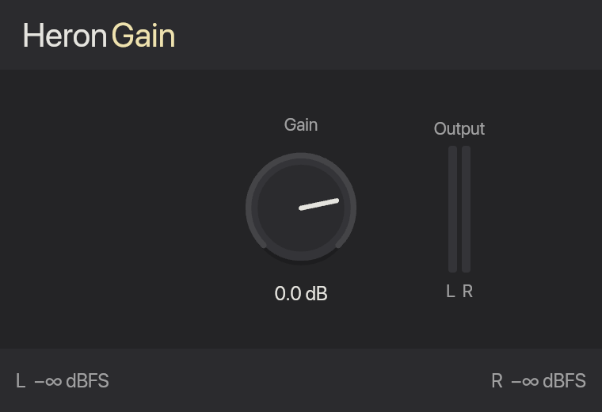
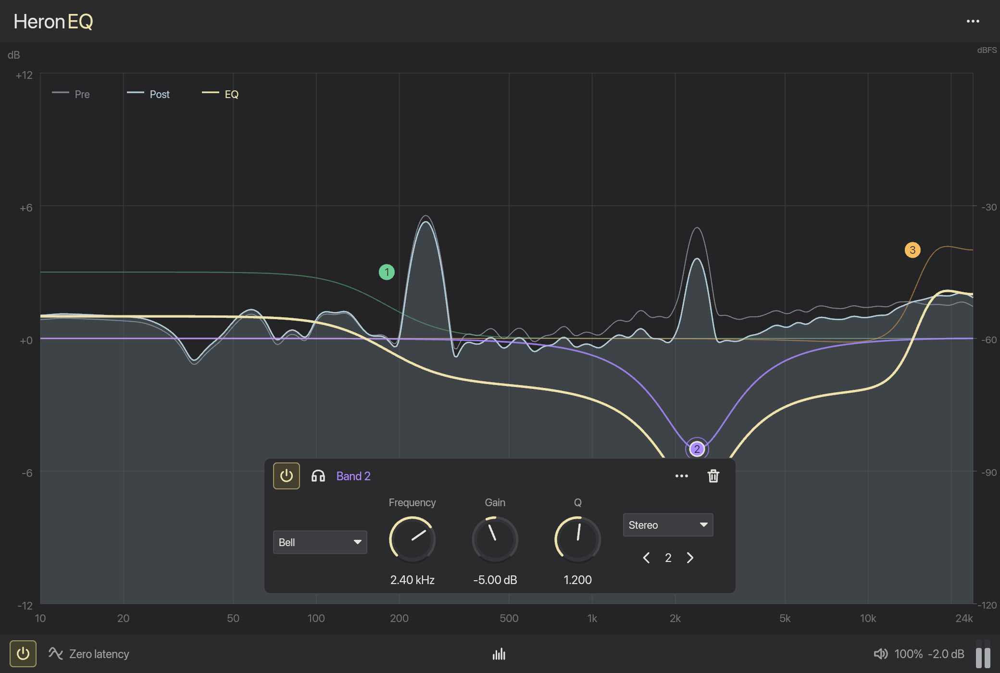
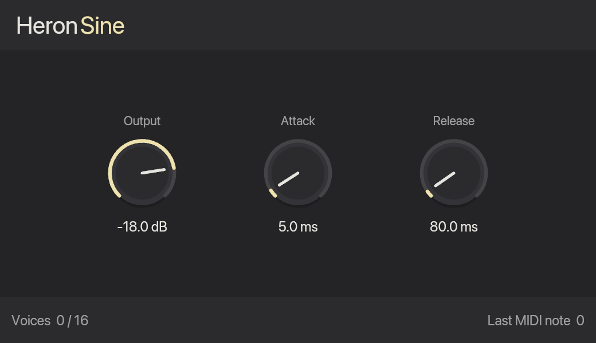
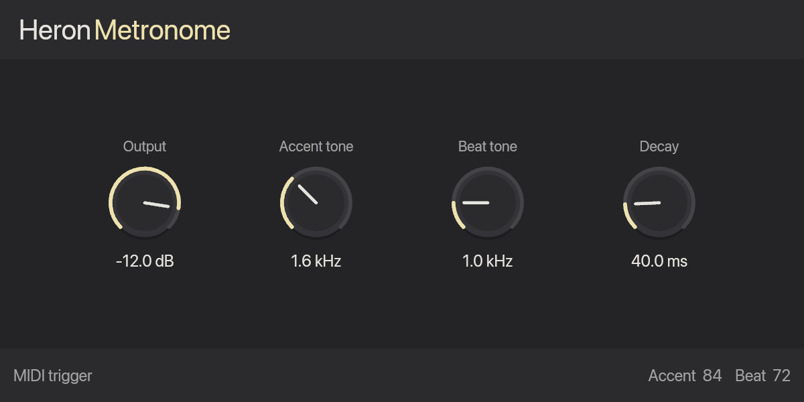

# Heron Plugins

Independently released plug-ins for [Heron](https://heron.minori.live/) and other
DAWs. Heron Gain, Heron EQ, Heron Sine, Heron Metronome, Heron Revox and Heron
Repitch share one suite version and preserve their VST3 identities, parameter
IDs and saved states. [Heron EQ](https://heron.minori.live/plugins/heron-eq) is
the suite's parametric equalizer. Revox is a neural-vocoder effect for vocal
phase cleanup and pitch shifting; Repitch is a traditional Rubber Band pitch
shifter with the same coarse/fine pitch controls.

| Plug-in         | Role                                                                                             |
| --------------- | ------------------------------------------------------------------------------------------------ |
| Heron Gain      | Gain effect                                                                                      |
| Heron EQ        | Parametric equalizer with spectrum display ([intro](https://heron.minori.live/plugins/heron-eq)) |
| Heron Sine      | MIDI sine synthesizer                                                                            |
| Heron Metronome | MIDI click instrument; note 84 accents and note 72 beats                                         |
| Heron Revox     | Neural vocoder for vocal phase cleanup and lower-loss pitch shifting                             |
| Heron Repitch   | Realtime Rubber Band pitch shifter (formant preserve, Faster/Finer windows)                      |

## Formats and platforms

The release suite provides VST3 bundles for Windows x64, Linux x64, Linux arm64
and universal macOS. macOS also includes AUv2 components and an installation
disk image. macOS requires 14.2 or later. AAX remains disabled until the
complete suite's SDK, identities, signing and native validation are ready.

Revox includes its models and ONNX Runtime 1.31.0 inside every bundle. CPU
inference requires no GPU driver or Python installation. macOS can use CoreML
when available and always has CPU fallback. The Intel macOS runtime is built
from the pinned upstream source release; both architectures are validated from
the final archive. Release builds fail if Revox cannot render shifted audio.

## Install

Download the suite runtime ZIP for your platform and format, then install the
complete bundles from its `bundles/` directory in your DAW's plug-in location.
macOS users can use the DMG's format folders and installation shortcuts, or
install the signed Universal suite (VST3 and AUv2) with Homebrew:

```sh
brew install --cask minori-live/tap/heron-plugins
```

That cask, maintained in
[`minori-live/homebrew-tap`](https://github.com/minori-live/homebrew-tap)
(`heron-plugins`), currently installs the four older plug-ins from the suite DMG.
Its bundle list needs a separate tap update to install Revox and Repitch; use the
ZIP or DMG installation instructions above for those plug-ins.
Quit and restart the DAW after installing. Heron bundles its own checksum-pinned
VST3 release and upgrades it with application updates.

Install a Revox or Repitch development build by copying the complete VST3 bundle
to `~/Library/Audio/Plug-Ins/VST3/` or the AU component to
`~/Library/Audio/Plug-Ins/Components/`, then restart the DAW. Those bundles use
ad-hoc signing and are not notarized release downloads.

## Plug-in screenshots

Native editors on macOS. Gain, Sine and Metronome show their default settings;
EQ shows a three-band example with the spectrum display.

### Heron Gain



### Heron EQ



### Heron Sine



### Heron Metronome



## Development

Use a login shell and the locked `mise` toolchain. On Windows, use PowerShell 7.
Follow [the development environment](agents/docs/environment.md) for platform
prerequisites and [the engineering and testing standards](agents/docs/README.md)
for implementation and review. The suite maintains these rules locally.

### Release suite

```sh
mise install
mise run install
mise run sdk:vst3
mise run check
mise run build
```

`mise run build` creates development bundle archives in `target/release-assets/`.
macOS builds and validates both Intel and Apple Silicon slices; Intel validation
on Apple Silicon requires Rosetta. Development macOS
bundles use ad-hoc signing. `node scripts/build.ts --release` requires valid Apple
release credentials and produces signed, notarized macOS downloads.

### Heron Repitch

Repitch links the vendored Rubber Band Library 4.0.0 single-file amalgamation
(`third_party/rubberband`) through `crates/rubberband-sys` and
`crates/heron-rubberband`. No extra model download is required. Release bundles
stage Rubber Band's GPL notices beside the shared third-party license tree.

### Heron Revox

Acquire and export the pinned FCPE and Revox models using the commands in the
[Revox development notes](agents/docs/environment.md) (required before workspace
Cargo checks that build `heron-revox`), then package:

```sh
pnpm build:revox
pnpm build:revox --au
```

The default builds VST3; `--au` also builds an AUv2 component and runs `auval`.
The ZIP and verified bundles are under `target/revox/bundles/` and
`target/revox/archive-check/macos-arm64/bundles/`.

The inference graphs are embedded; Python and model downloads are unnecessary
on the playback machine. Fixed processing windows automatically use batch 1 for
mono or batch 2 for stereo, preserving each channel without additional batching
delay. Each bundle includes ONNX Runtime, FCPE's MIT license, the Revox model
provenance using its GPL-3.0-only option, and runtime license notices.

The focused Apple Silicon `build:revox` command remains available for development;
`mise run build` packages the complete release suite on every release platform.
For standalone Rust tests, first run `node scripts/revox-runtime.ts` and set
`ORT_DYLIB_PATH` to its printed absolute path. Installed bundles ignore that
variable and resolve their runtime relative to the plug-in module.

### Versioning and releases

Change `VERSION`, then run `pnpm version:sync`, `cargo check --workspace` and
`pnpm version:check` to synchronize suite metadata and the Cargo lockfile before
tagging. Tag pushes run all checks and create a draft GitHub Release. Publishing
a stable release runs this repository's workflow to validate the release using
Heron's artifact consumer and maintain one manually merged Heron upgrade PR.
It also notifies [`minori-live/homebrew-tap`](https://github.com/minori-live/homebrew-tap)
so the macOS Cask can track the Universal DMG. The scoped synchronization tokens
live only in this repository. If Heron main is not yet bootstrapped or an upgrade
attempt fails, retry the workflow manually; the published plug-in release remains
available. Homebrew notification recovery is documented in
[Homebrew distribution](agents/docs/homebrew-distribution.md).

GitHub downloads contain runtime bundles and installers. Plug-ins do not
publish symbols or integrate with Sentry.

See [CI and release operations](agents/docs/ci.md),
[the artifact contract](agents/docs/artifacts.md) and
[the migration decision](agents/docs/adr/0001-independent-plugin-releases.md).
The [EQ implementation notes](agents/docs/heron-eq.md) preserve its DSP, editor
and compatibility contracts.
Licensed under [GPL-3.0-only](LICENSE); bundles include third-party notices.
